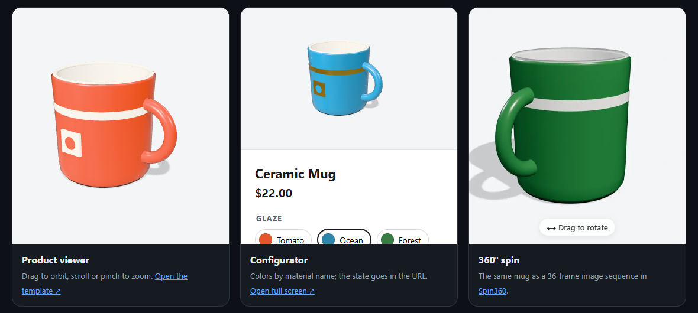

<div align="center">

# 🧊 Three.js Product Skills

**Agent skills that teach Claude Code, Codex and other AI coding agents to build 3D product pages: viewers, configurators, AR embeds and 360° spins.**

Tested templates · current three.js (r186) APIs · real performance budgets · no build step

[](https://ahmettasdemirusa.github.io/threejs-product-skills/)

[](LICENSE)


-8A2BE2)


[](https://ahmettasdemirusa.github.io/threejs-product-skills/)

</div>

---

## Why

Ask an AI agent for "a 3D product viewer" and you often get code that:

- mixes three.js versions, or uses APIs that were removed (e.g. `PCFSoftShadowMap`, removed in r18x)
- hard-codes the camera, so real models appear tiny or clipped
- has no environment lighting, so PBR materials look dull
- renders 60 frames a second while idle, draining phone batteries
- breaks the moment the model is optimized, because it can't decode Meshopt or KTX2

These skills give your agent **working, tested templates** and the reasoning behind every choice.

## The skills

| Skill | What your agent can do with it |
|---|---|
| [`threejs-product-viewer`](skills/threejs-product-viewer/SKILL.md) | Build a viewer that auto-frames any GLB, lights it like a studio, adds a contact shadow and renders only on demand. **[Template](skills/threejs-product-viewer/templates/product-viewer.html)** |
| [`product-configurator`](skills/product-configurator/SKILL.md) | Colors, finishes, textures and parts by material name, plus KHR_materials_variants, URL state, pricing and an accessible option UI. **[Template](skills/product-configurator/templates/configurator.html)** |
| [`3d-asset-optimization`](skills/3d-asset-optimization/SKILL.md) | Shrink models with glTF-Transform: Meshopt vs Draco, KTX2 vs WebP, budgets, and the default flags that silently break configurators |
| [`model-viewer-ar`](skills/model-viewer-ar/SKILL.md) | `<model-viewer>` embeds with AR on Android and iOS, true-scale checks, variants and a custom AR button |
| [`360-product-spin`](skills/360-product-spin/SKILL.md) | 360° spins from photos or renders, embedded with [Spin360](https://github.com/ahmettasdemirusa/spin360) |

## Install

### Claude Code

```
/plugin marketplace add ahmettasdemirusa/threejs-product-skills
/plugin install threejs-product-skills@threejs-product-skills
```

Or copy skill folders into `~/.claude/skills/` (all projects) or `.claude/skills/` (one project).

### Other agents (Codex, Cursor, Gemini CLI and more)

The skills use the open **Agent Skills** format: a folder with a `SKILL.md`. Copy the folders from [`skills/`](skills) to wherever your agent loads skills from, or point it at [`AGENTS.md`](AGENTS.md).

## Try it

> "Add a 3D viewer for `sofa.glb` to our product page. It must be fast on phones."
>
> "Make a configurator where customers pick the cabinet door color and handle finish, and put the choice in the URL."
>
> "This GLB is 48 MB. Get it under 3 MB without breaking our color picker."
>
> "Add 'view in your room' AR for our lamps on iPhone and Android."
>
> "We only have turntable photos of our sneakers. Make a 360° view."

## Tested, not just written

Every template in this repo was run in a real browser before release:

- **The demo model** ([`assets/mug.glb`](assets/mug.glb)) is exported from three.js by [`tools/export_mug.py`](tools/export_mug.py).
- **It was optimized with glTF-Transform 4.5.1** into [`assets/mug-optimized.glb`](assets/mug-optimized.glb), from 129 KB to 31 KB, with all mesh and material names kept.
- **Both templates load the optimized file,** which exercises the Meshopt decoder.
- **The configurator** was checked with URL state (`?glaze=forest&band=gold`) and pricing, in desktop and stacked mobile layouts.

That testing found real problems, and each fix is now in a skill:
- `PCFSoftShadowMap` was removed in r18x.
- A configurator without `MeshoptDecoder` fails on optimized files.
- `optimize --join` merges meshes by default. On the demo mug it turned 8 meshes into 4.

## Repository layout

```
skills/
├── threejs-product-viewer/   SKILL.md + templates/product-viewer.html
├── product-configurator/     SKILL.md + templates/configurator.html
├── 3d-asset-optimization/    SKILL.md
├── model-viewer-ar/          SKILL.md
└── 360-product-spin/         SKILL.md
assets/    demo model (original and optimized)
tools/     exports the demo model with three.js in headless Chrome
index.html live demo (GitHub Pages)
```

## 3D Web series

| | |
|---|---|
| 🔄 **[Spin360](https://github.com/ahmettasdemirusa/spin360)** | Zero-dependency 360° product viewer web component |
| 🧊 **Three.js Product Skills** | Agent skills for 3D product pages (this repo) |
| 🌐 **[Awesome 3D Web](https://github.com/ahmettasdemirusa/awesome-3d-web)** | A curated list of libraries, tools and resources for 3D on the web |

## Contributing

Pull requests are welcome, especially new templates (hotspots, exploded views, room planners), WebGPU variants, and fixes when three.js changes an API. Please test in a browser and include what you checked.

## License

[MIT](LICENSE) © Ahmet Tasdemir

---

<div align="center">

If these skills help your agent, a ⭐ helps other people find them.

Built by **[Ahmet Tasdemir](https://github.com/ahmettasdemirusa)**, software engineer · [ahmettasdemir.com](https://ahmettasdemir.com)

</div>
